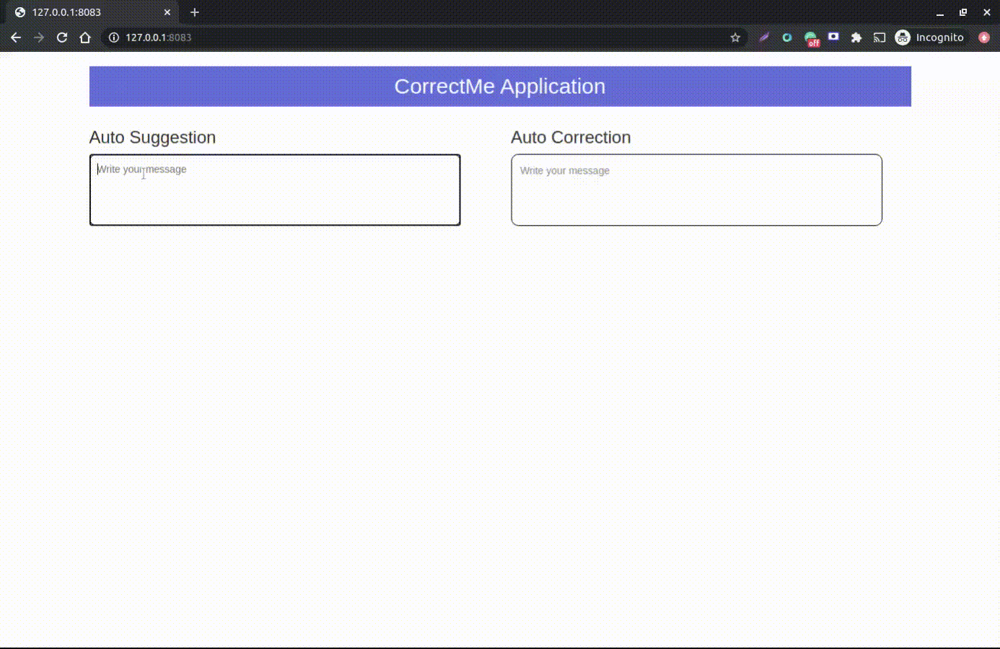
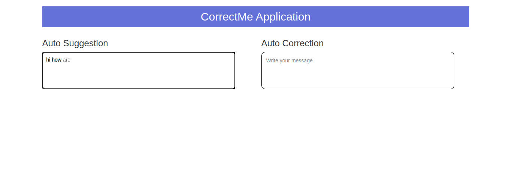

# CorrectMe
This Project contains two API one is auto-corrections and other is autosuggestions.
Auto-correction build with the help of text blob library and other one is auto-suggestions with the help of transforms and Bart large model.

## Project Intro

The purpose of this project is to train the next word predicting models. Models should be able to suggest the next word after the user has input word/words auto-correct the incorrect word/s.
Autocorrect the incorrect word in the input field like Gmail and Grammarly doing.

### Methods Used
* Language Prediction
* Natural Language Processing
* Transformers Bart Model
* Textblob

### Technologies
* Python
* Python Flask
* Torch, Transforms
* JS, HTML

## Project Description
* `app.py` - In that file three APIs are there, one is auto_correction and the second one is auto_suggestion and the last one is index file rendering file.
* `main.py` - use pre-trained Bart model for next word prediction

## Process Flow
- Frontend Development
- Data Collection
- Data Processing/Cleaning
- Words Tokenizing
- Model Training
- Demo Development

## Getting Started

### Prerequisites
1. Create a python virtual environment via command
`virtualenv correctme_env -p python3`

2. Install python dependencies via command
`pip3 install -r requirement.txt`

3. Start server via command `python3 app.py`.

4. Open your browser at http://127.0.0.1:8083/

